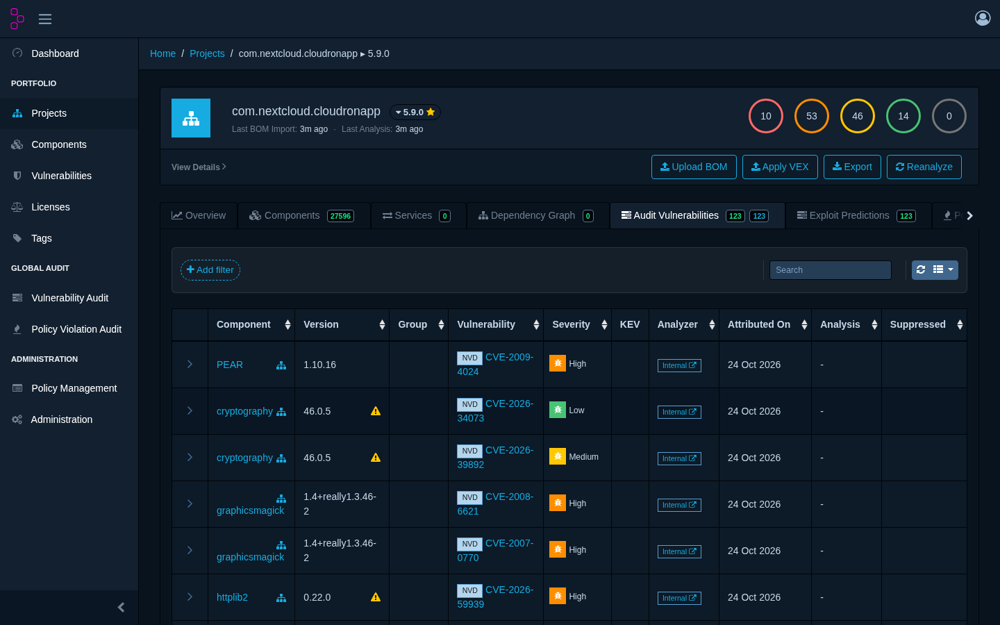

# Dependency-Track for Cloudron

[OWASP Dependency-Track](https://dependencytrack.org) packaged for Cloudron. Upload CycloneDX SBOMs and track known vulnerabilities, outdated components and licenses across all projects.

* Sign in with Cloudron, Cloudron groups map to Dependency-Track teams
* Email notifications are sent through the Cloudron mail server
* Data is stored in the Cloudron PostgreSQL addon and included in backups

## Install

In Cloudron, open 'Add custom app' and enter `https://raw.githubusercontent.com/BrutalBirdie/Cloudron-Dependency-Track-App/main/CloudronVersions.json`.

Changes per version are in the [releases](https://github.com/BrutalBirdie/Cloudron-Dependency-Track-App/releases).
